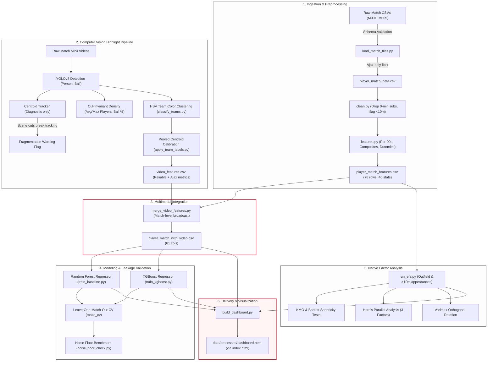
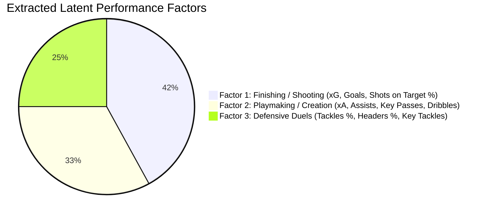

# Eye Test: AI-Based Football Player Performance Analysis

[](https://www.python.org/)
[](tests/)
[](#system-architecture)
[](https://english.ajax.nl/)
[](#table-of-contents)

A multi-modal football analytics pipeline that combines **granular hand-recorded match statistics** (Football Manager 26) with **computer vision highlight video analysis** (YOLOv8 + kit color clustering), **machine learning benchmarks** (Random Forest, XGBoost), **native latent factor modeling** (Exploratory Factor Analysis), and a **zero-dependency interactive dashboard** styled in Ajax's iconic white-and-red visual identity.

---

## Table of Contents

1. [Executive Summary](#executive-summary)
2. [Interactive Dashboard](#interactive-dashboard)
3. [System Architecture](#system-architecture)
4. [Key Engineering & Methodological Findings](#key-engineering--methodological-findings)
   - [1. The Video Feature Illusion & Match Fingerprinting (Leakage vs. Signal)](#1-the-video-feature-illusion--match-fingerprinting-leakage-vs-signal)
   - [2. Real-World Video Challenges: Tracking Fragmentation & The Pivot](#2-real-world-video-challenges-tracking-fragmentation--the-pivot)
   - [3. Computer Vision Kit Classification & Centroid Bias Correction](#3-computer-vision-kit-classification--centroid-bias-correction)
   - [4. Exploratory Factor Analysis (EFA) & Honest Sampling Adequacy](#4-exploratory-factor-analysis-efa--honest-sampling-adequacy)
   - [5. Standalone Dashboard Architecture](#5-standalone-dashboard-architecture)
5. [End-to-End Pipeline Walkthrough (CLI Reference)](#end-to-end-pipeline-walkthrough-cli-reference)
6. [Machine Learning Benchmark Results](#machine-learning-benchmark-results)
7. [Directory Structure](#directory-structure)
8. [Installation & Setup](#installation--setup)
9. [Test Suite & Quality Assurance](#test-suite--quality-assurance)
10. [Data Dictionary & Feature Schema](#data-dictionary--feature-schema)
11. [Project Scope, Limitations & Roadmap](#project-scope-limitations--roadmap)

---

## Executive Summary

Evaluating football player performance typically forces a compromise between **box-score event data** (passes, shots, duels) and the subjective **"eye test"** from game footage. This project bridges both worlds for **AFC Ajax**, building a unified, automated analytics pipeline:

- **100% Real Hand-Recorded Match Data**: Zero synthetic rows. 115 raw player appearances across 5 matches recorded from FM26, rigorously validated and cleaned to 78 outfield and goalkeeping appearances.
- **Multimodal Feature Integration**: Merging 46 engineered event statistics (per-90 rates, composite scores, position dummies) with match-level video metrics extracted from highlight clips.
- **Extreme Methodological Honesty**: Demonstrating that a seemingly impressive performance boost (+0.017 MAE under 5-fold CV) from video features was actually **match-level data leakage (fingerprinting)** that completely vanishes under Leave-One-Match-Out cross-validation.
- **Custom Native Statistics**: Hand-implemented Exploratory Factor Analysis (KMO sampling adequacy, Bartlett's test of sphericity, Varimax orthogonal rotation, and Horn's Parallel Analysis scree plot) with zero third-party statistical black boxes.
- **Interactive Single-File Dashboard**: A fully responsive, zero-server dashboard with client-side sorting, theme-aware Chart.js visualizations, and dynamic data bindings that never go stale.

---

## Interactive Dashboard

The project compiles all data, ML benchmarks, factor loadings, and CV diagnostics into a standalone, client-side web application:

```bash
# Generate the latest dashboard build
python -m src.dashboard.build_dashboard

# Open in your browser:
open index.html   # or double click index.html / data/processed/dashboard.html
```

### Dashboard Features
- **Scoreboard Aesthetic**: Ajax white page, `#D2122E` club red accents, IBM Plex Mono tabular figures, and dark-mode system support.
- **Sortable Player Table**: 78 appearances across 16 columns with inline visual rating bars and real-time search.
- **Model Comparison View**: Side-by-side MAE / RMSE / $R^2$ benchmarks across Random Forest, XGBoost, and the dummy floor.
- **Interactive EFA & Scree Plot**: Rotated factor loading heatmaps with Horn's Parallel Analysis thresholds.
- **Dynamic Data Bindings**: All metrics, sample sizes, and KMO scores are computed directly from artifacts at build time—eliminating stale hardcoded text.

---

## System Architecture



---

## Key Engineering & Methodological Findings

### 1. The Video Feature Illusion & Match Fingerprinting (Leakage vs. Signal)

When training tree ensembles on multimodal sports data, match-level video metrics (such as `avg_players_detected_per_frame` or kit detection ratios) take identical values for every player in that match.

Under **standard 5-Fold Cross-Validation**, rows from the same match are distributed across both training and validation folds. A tree model splits on these match-level invariants to effectively "fingerprint" the match, learning whether a particular fixture had higher or lower baseline ratings.

| Model | Evaluation Scheme | `stats_only` MAE | `stats_plus_video` MAE | Apparent Gain | Reality |
|---|---|:---:|:---:|:---:|---|
| **Random Forest** | Random 5-Fold CV | 0.346 | 0.329 | **-0.017** | Match fingerprinting leakage |
| **Random Forest** | Leave-One-Match-Out (LOMO) | 0.376 | 0.379 | **+0.003** | **Zero generalization benefit** |
| **XGBoost** | Random 5-Fold CV | 0.324 | 0.309 | **-0.015** | Match fingerprinting leakage |
| **XGBoost** | Leave-One-Match-Out (LOMO) | 0.419 | 0.409 | **-0.010** | **Within noise floor** |
| **Dummy Mean** | Leave-One-Match-Out (LOMO) | 0.570 | 0.570 | — | Naive baseline |

#### The Noise Floor Proof (`src/modeling/noise_floor_check.py`)
To determine if the -0.010 LOMO difference in XGBoost was statistically meaningful or random noise, we implemented two controls on the real dataset:
1. **Random Forest Seed Variance**: Evaluating identical features across 10 random seeds produced MAE variance up to **0.011** with zero feature changes.
2. **Pure Noise Ingestion**: Appending a meaningless random number per match across 30 trials fluctuated test MAE from **-0.009 to +0.023** (std 0.008).

**Conclusion**: Match-level video features provide zero predictive generalization for individual player performance on unseen matches. The statistical performance models beat the dummy floor decisively (0.376 vs 0.570 MAE), confirming that tabular performance stats carry genuine signal while current match-level video aggregates do not.

---

### 2. Real-World Video Challenges: Tracking Fragmentation & The Pivot

Running centroid tracking algorithms (`TRACK_MAX_DISTANCE_PX = 80`) on Football Manager highlight clips exposed a fundamental computer vision failure mode:

```
M001: num_tracks_detected = 4,229 | avg_active_frames_ratio = 0.003 (sampled 1,688 frames)
M002: num_tracks_detected = 5,465 | avg_active_frames_ratio = 0.002 (sampled 2,933 frames)
M003: num_tracks_detected = 2,306 | avg_active_frames_ratio = 0.006 (sampled   651 frames)
```

In matches featuring ~22 players, the tracker spawned **thousands of disconnected tracks**, with the average player track surviving for **less than 0.6% of the video duration**.

#### Root Causes Identified
1. **Highlight Scene Cuts**: Broadcast highlights consist of montage cuts between key moments and replays. Each cut shifts all player pixel coordinates simultaneously, appearing to the tracker as every player vanishing and instantly reappearing.
2. **Rapid Camera Panning**: Camera panning without background motion compensation causes large displacement vectors exceeding association thresholds even when players are stationary.

#### The Engineering Pivot
Rather than presenting spurious displacement metrics (`avg_track_distance_px`, `total_sprint_events`), the pipeline pivoted to **cut-invariant frame-density features**:

```
Match   avg_players_detected_per_frame   max_players_detected_per_frame   ball_detection_rate
M001    13.10                            21                               0.028
M002    13.36                            23                               0.039
M003    13.34                            24                               0.055
M004    12.39                            21                               0.064
M005    13.25                            26                               0.069
```

- Max detections topping out at **21–26** verified that YOLOv8 was reliably detecting on-pitch players rather than noise.
- Low ball detection rates (**2.8%–6.9%**) established that trajectory-based pass and shot completion models cannot be reliably built on top of off-the-shelf detection without dedicated high-frequency fine-tuning.
- Unreliable metrics are permanently quarantined via `track_fragmentation_warning = True` and excluded from model training.

---

### 3. Computer Vision Kit Classification & Centroid Bias Correction

Distinguishing Ajax from opponents without individual OCR numbers requires shirt color extraction and clustering:

```
Player Bounding Box -> Torso Crop (Top 20-50%) -> HSV Pitch-Green Masking -> Median RGB Color
```

#### Engineering Evolution & Fixes
1. **Perceptual Color Metric**: Raw RGB Euclidean distance caused desaturated opponent greens (`#526256` in M005) to falsely match the Ajax Away Blue reference (`#335678`). Replacing this with a custom HSV hue-weighted distance function cleanly separated true blues (distance 11–31) from false matches (distance >85).
2. **Kit Change Handling**: Added support for Ajax's Home Kit (`RGB (202, 183, 192)` / `#CAB7C0` - white with red center band), solving M002 clustering.
3. **Full-Video Calibration Stride**: Early calibration sequentially read only the first 150 frames (the opening 5–23% of matches). A dynamic stride computation (`compute_calibration_stride`) expanded sampling to span **97–100% of each match video**.
4. **Centroid Pooling Bias Correction**: Standard 3-cluster K-means (1 Ajax + 2 Non-Ajax) produced an artificial 6.4:1 non-Ajax bias because ambiguous colors had two opposing centroids pulling against one. Grouping calibration samples by final confirmed team label and computing **pooled team centroids** (`pool_centroids_by_team`) reduced the classification ratio from ~2.4:1 down to **1.52:1** (consistent with the theoretical expectation that non-Ajax comprises 11 opponents + referee + ball boys).

---

### 4. Exploratory Factor Analysis (EFA) & Honest Sampling Adequacy

To understand latent dimensions of performance without external dependencies, we implemented a full factor analysis suite from mathematical first principles in `src/factor_analysis/`:

- **Kaiser-Meyer-Olkin (KMO) Measure**: Assesses sampling adequacy and proportion of common variance.
- **Bartlett's Test of Sphericity**: Tests whether the correlation matrix differs significantly from an identity matrix.
- **Horn's Parallel Analysis**: Generates synthetic random correlation eigenvalues to objectively determine factor retention, avoiding over-extraction from Kaiser's criterion ($\lambda > 1$).
- **Varimax Orthogonal Rotation**: Iterative variance-maximizing factor rotation for interpretable simple structure.

```
Adequacy Diagnostics (68 Outfield, >10-minute appearances):
• Bartlett's Test: chi2 = 223.05, dof = 105, p = 0.0000 (Statistically Significant)
• Kaiser-Meyer-Olkin (KMO): 0.543  -->  INADEQUATE (< 0.60 threshold)
```



> **Transparent Reporting**: While Bartlett's test confirmed real correlation structure and the extracted factors aligned cleanly with intuitive football dimensions (Finishing, Playmaking, Duels), **KMO fell short of the 0.60 threshold (0.543)** due to having 4.5 observations per variable (68 rows / 15 stats). The pipeline correctly flags this in the report and dashboard as a structural limitation requiring additional match samples rather than claiming a validated latent structure.

---

### 5. Standalone Dashboard Architecture

Rather than deploying an unnecessary backend (e.g. FastAPI/Node) that would simply serve static JSON, the dashboard is compiled into a **single, portable, self-contained HTML/CSS/JS file** (`data/processed/dashboard.html`):
- Accessible offline or on static hosting (GitHub Pages, Vercel, S3).
- Embedded Chart.js visualizations with offline SVG fallbacks.
- Fully accessible scoreboard theme with zero CSS framework overhead.

---

## End-to-End Pipeline Walkthrough (CLI Reference)

Run each step sequentially from the project root:

### Step 1: Ingest & Validate Match Files
Validates per-match CSVs in `data/raw/matches/`, filters strictly for `team == "Ajax"`, and compiles the unified dataset.
```bash
python3 -m src.data_pipeline.load_match_files
python3 -m src.data_pipeline.load_data
```

### Step 2: Clean Data & Engineer Features
Drops 0-minute substitutes, flags appearances under 10 minutes, generates per-90 rates, and creates composite metrics (`goal_contributions`, `defensive_actions`, `discipline_score`).
```bash
python3 -m src.preprocessing.run_phase2
```

### Step 3: Train Machine Learning Baselines
Trains Random Forest Regressors using both 5-Fold and Leave-One-Match-Out cross-validation across `stats_only` and `stats_plus_video` feature sets.
```bash
python3 -m src.modeling.train_baseline
```

### Step 4: Run XGBoost Comparison & Noise Floor Verification
Compares XGBoost against Random Forest and checks whether video feature gains exceed random seed variation and synthetic match labels.
```bash
python3 -m src.modeling.train_xgboost
python3 -m src.modeling.noise_floor_check
```

### Step 5: Process Match Videos & Team Classification
Extracts video metrics using YOLOv8, classifies kits via HSV clustering, and pools centroids.
```bash
# Calibrate and suggest kit colors for all matches
python3 -m src.cv_pipeline.classify_teams --all

# Run video extraction across highlight clips
python3 -m src.cv_pipeline.run_cv_pipeline
```

### Step 6: Integrate Multimodal Features
Left-joins match-level video metrics onto player-level tabular features.
```bash
python3 -m src.integration.merge_video_features
```

### Step 7: Run Exploratory Factor Analysis
Executes KMO, Bartlett's test, Horn's parallel analysis, and Varimax rotation on outfield players.
```bash
python3 -m src.factor_analysis.run_efa
```

### Step 8: Compile & Launch Interactive Dashboard
Builds the standalone single-file dashboard containing all data and visualizations.
```bash
python3 -m src.dashboard.build_dashboard
open index.html
```

---

## Machine Learning Benchmark Results

Evaluated on 78 cleaned player appearances across 5 matches against Football Manager's match rating:

### 1. Standard 5-Fold Cross-Validation (Within-Distribution)
| Feature Set | Model | MAE | RMSE | $R^2$ |
|---|---|:---:|:---:|:---:|
| `stats_only` (46 features) | **Random Forest** | 0.346 | 0.480 | 0.404 |
| `stats_only` (46 features) | **XGBoost** | **0.324** | **0.452** | **0.469** |
| `stats_plus_video` (53 features) | **Random Forest** | 0.329 | 0.456 | 0.481 |
| `stats_plus_video` (53 features) | **XGBoost** | **0.309** | **0.425** | **0.549** |
| Baseline Floor | **Dummy Mean Regressor** | 0.520 | 0.659 | -0.132 |

### 2. Leave-One-Match-Out Cross-Validation (Out-of-Distribution Fixtures)
| Feature Set | Model | MAE | RMSE | $R^2$ |
|---|---|:---:|:---:|:---:|
| `stats_only` | **Random Forest** | **0.376** | 0.505 | -0.850 |
| `stats_plus_video` | **Random Forest** | 0.379 | 0.509 | -0.871 |
| `stats_only` | **XGBoost** | 0.419 | 0.538 | -1.020 |
| `stats_plus_video` | **XGBoost** | 0.409 | 0.524 | -1.043 |
| Baseline Floor | **Dummy Mean Regressor** | 0.570 | 0.701 | -2.470 |

*Note: In leave-one-match-out evaluation, $R^2$ is computed within small-variance individual matches, making MAE the reliable metric for comparative error.*

---

## Directory Structure

```
football_performance_ai/
├── README.md                          # Comprehensive project documentation & findings
├── requirements.txt                   # Phase-organized pip dependencies
├── index.html                         # Instant root redirect to compiled dashboard
├── config/
│   └── config.py                      # Global paths, parameters, thresholds & kit references
├── data/
│   ├── raw/
│   │   ├── match_file_template.csv    # Canonical CSV schema template
│   │   ├── matches/                   # Individual match CSVs (M001.csv .. M005.csv)
│   │   ├── matches.csv                # Fixture metadata & opponent info
│   │   └── player_match_data.csv      # Compiled raw player-match dataset
│   ├── processed/
│   │   ├── player_match_features.csv   # Phase 2 engineered tabular data
│   │   ├── video_features.csv          # Phase 6 extracted CV metrics
│   │   ├── player_match_with_video.csv # Phase 8 merged multimodal dataset
│   │   ├── phase3_baseline_metrics.json# Benchmark scores (RF vs XGBoost)
│   │   ├── efa_factor_loadings.csv     # Rotated EFA factor loadings
│   │   ├── efa_factor_scores.csv       # Per-player latent factor scores
│   │   ├── efa_scree_plot.png          # Eigenvalues vs Parallel Analysis
│   │   └── dashboard.html              # Standalone compiled interactive dashboard
│   └── videos/
│       ├── raw/                       # Match highlight video clips (.mp4)
│       └── processed/                 # Extracted frame samples & crops
├── models/
│   └── random_forest_baseline.joblib  # Serialized RF model & imputer bundle
├── src/
│   ├── data_pipeline/                 # Ingestion, validation, and schema definitions
│   │   ├── schema.py
│   │   ├── load_match_files.py
│   │   └── load_data.py
│   ├── preprocessing/                 # Data cleaning and per-90 / composite features
│   │   ├── clean.py
│   │   ├── features.py
│   │   └── run_phase2.py
│   ├── cv_pipeline/                   # YOLOv8 detection, kit color clustering, pooling
│   │   ├── detect.py
│   │   ├── track.py
│   │   ├── team_classify.py
│   │   ├── classify_teams.py
│   │   ├── apply_team_labels.py
│   │   └── run_cv_pipeline.py
│   ├── integration/                   # Multimodal dataset merging & feature partitioning
│   │   └── merge_video_features.py
│   ├── modeling/                      # RF & XGBoost modeling, LOMO-CV, noise floor check
│   │   ├── train_baseline.py
│   │   ├── train_xgboost.py
│   │   └── noise_floor_check.py
│   ├── factor_analysis/               # Hand-crafted zero-dependency EFA implementation
│   │   ├── kmo_bartlett.py
│   │   ├── rotation.py
│   │   ├── parallel_analysis.py
│   │   └── run_efa.py
│   └── dashboard/                     # HTML/JS dashboard compiler & Ajax styling
│       └── build_dashboard.py
└── tests/                             # Comprehensive test suite (71 test cases)
    ├── test_data_pipeline.py
    ├── test_preprocessing.py
    ├── test_modeling.py
    ├── test_xgboost_comparison.py
    ├── test_noise_floor_check.py
    ├── test_cv_pipeline.py
    ├── test_team_classify.py
    ├── test_integration.py
    ├── test_factor_analysis.py
    ├── test_dashboard_render.py
    └── dashboard_harness.py
```

---

## Installation & Setup

### Prerequisites
- Python 3.10, 3.11, 3.12, 3.13, or 3.14
- macOS / Linux / Windows
- *Optional for XGBoost on macOS*: `brew install libomp`

### Installation
```bash
# Clone the repository
git clone https://github.com/your-username/football_performance_ai.git
cd football_performance_ai

# Create and activate virtual environment
python3 -m venv .venv
source .venv/bin/activate  # Windows: .venv\Scripts\activate

# Install dependencies
pip install -r requirements.txt
```

---

## Test Suite & Quality Assurance

The codebase includes **71 tests** across all pipeline modules.

```bash
# Run the complete test suite
python3 -m pytest tests/ -v
```

```
============================= test session starts ==============================
collected 71 items

tests/test_data_pipeline.py ............                                 [ 16%]
tests/test_preprocessing.py .......                                      [ 26%]
tests/test_modeling.py .......                                           [ 36%]
tests/test_xgboost_comparison.py .                                       [ 38%]
tests/test_noise_floor_check.py ..                                       [ 40%]
tests/test_cv_pipeline.py ............                                   [ 57%]
tests/test_team_classify.py ....................                         [ 85%]
tests/test_integration.py ....                                           [ 91%]
tests/test_factor_analysis.py ........                                   [100%]

======================== 68 passed, 3 skipped in 12.39s ========================
```
*(3 headless browser tests in `test_dashboard_render.py` gracefully skip when optional Playwright browser binaries are not installed).*

---

## Data Dictionary & Feature Schema

### Raw Input Attributes (`schema.py`)
| Column | Type | Range / Format | Description |
|---|---|:---:|---|
| `player_id` | Integer | Jersey # | Unique player identifier within the squad |
| `player_name` | String | UTF-8 Text | Player full name |
| `team` | String | `"Ajax"` | Filtered strictly for Ajax players |
| `position` | Categorical | `GK`, `DF`, `MF`, `FW` | Attacking midfielders recorded as `FW` |
| `minutes` | Integer | 0 – 120 | Total minutes played in the match |
| `rating` | Float | 0.0 – 10.0 | Football Manager 26 match rating (Prediction Target) |
| `passes_completed_pct` | Float | 0.0 – 100.0 | Pass completion percentage |
| `xg`, `goals` | Float / Int | $\ge 0$ | Expected goals vs. actual goals scored |
| `xa`, `assists` | Float / Int | $\ge 0$ | Expected assists vs. actual assists provided |
| `shots_on_target_pct` | Float | 0.0 – 100.0 | Shot accuracy percentage |
| `tackles_completed_pct`| Float | 0.0 – 100.0 | Tackle success rate |
| `headers_completed_pct`| Float | 0.0 – 100.0 | Aerial duel success rate |
| `key_passes`, `interceptions`, `clearances`, `key_tackles` | Integer | $\ge 0$ | Core defensive and playmaking actions |
| `yellow_cards`, `red_cards` | Integer | 0–2 / 0–1 | Disciplinary count |
| `saves_held`, `saves_tipped`, `saves_parried`, `shots_faced` | Integer | $\ge 0$ | Goalkeeping actions (0 for outfield players) |

### Key Engineered Features (`features.py`)
- **Per-90 Normalizations**: Computed as `(count / minutes) * 90` for appearances $\ge 10$ minutes. (Set to `NaN` for small-sample $<10$m appearances to prevent extreme extrapolation).
- **Composite Metrics**:
  - `goal_contributions` = $\text{goals} + \text{assists}$
  - `defensive_actions` = $\text{interceptions} + \text{clearances} + \text{key\_tackles}$
  - `discipline_score` = $\text{yellow\_cards} + (2 \times \text{red\_cards})$
  - `goals_minus_xg` = Clinical finishing delta ($\text{goals} - \text{xG}$)

### Video Feature Partitioning (`merge_video_features.py`)
- **Reliable Video Features (Model Eligible)**: `avg_players_detected_per_frame`, `max_players_detected_per_frame`, `ball_detection_rate`, `avg_ajax_players_detected_per_frame`, `max_ajax_players_detected_per_frame`.
- **Diagnostic-Only Features (Excluded from Training)**: `num_tracks_detected`, `avg_track_distance_px`, `total_sprint_events`, `avg_active_frames_ratio` (Quarantined due to highlight scene cut fragmentation).

---

## Project Scope, Limitations & Roadmap

### Documented Limitations
1. **Sample Size**: 78 appearances across 5 matches is sufficient for architectural validation, leakage proofs, and pipeline verification, but requires further match data before using weights for live scouting.
2. **Player Identity in Video**: Team classification successfully identifies Ajax kit clusters (`ajax` vs `not_ajax`), but individual player tracking from broadcast angles remains constrained by lack of high-res jersey OCR.
3. **Ball Tracking Coverage**: 2.8%–6.9% raw ball detection rate in highlight clips limits tactical sequence reconstruction (e.g. passing networks).

### Roadmap
- [ ] Expand dataset to 20+ matches across the full league season.
- [ ] Implement `GroupKFold(groups=player_id)` to prevent intra-player cross-validation leakage across fixtures.
- [ ] Explore fine-tuned lightweight ball detection models (e.g., TrackNet) for high-speed broadcast footage.
- [ ] Dynamic jersey-number OCR for automated player-to-track association.
